# Emotion Control - ROS 2 Week 8

Package nhan dien cam xuc khuon mat bang webcam va dieu khien TurtleBot 4 trong mo phong Small House.

## Chuc nang

- MediaPipe Face Landmarker voi 478 diem khuon mat va Face Blendshapes.
- MediaPipe Hand Landmarker de nhan dien tay gan vung mieng khi Fear.
- Nhan dien: Happy, Sad, Angry, Surprise, Fear va Neutral.
- Loc toi thieu 3 frame lien tiep de giam nhieu.
- Ket noi ket qua voi /facial_emotion va /cmd_vel.
- Hien thi anh ket qua trong thu muc results/.

## Anh ket qua

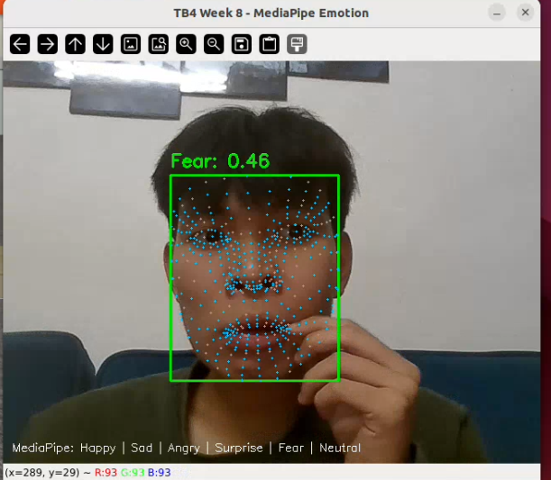

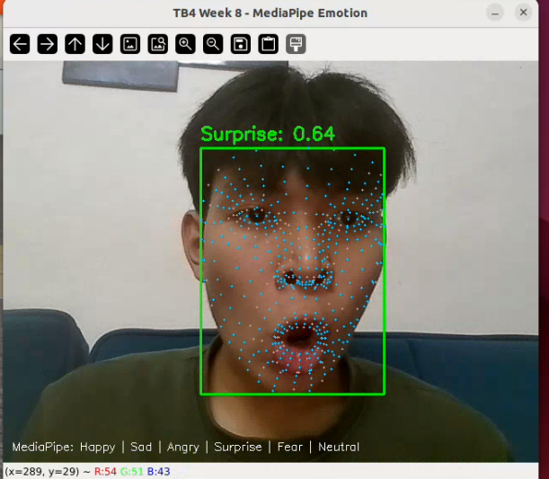

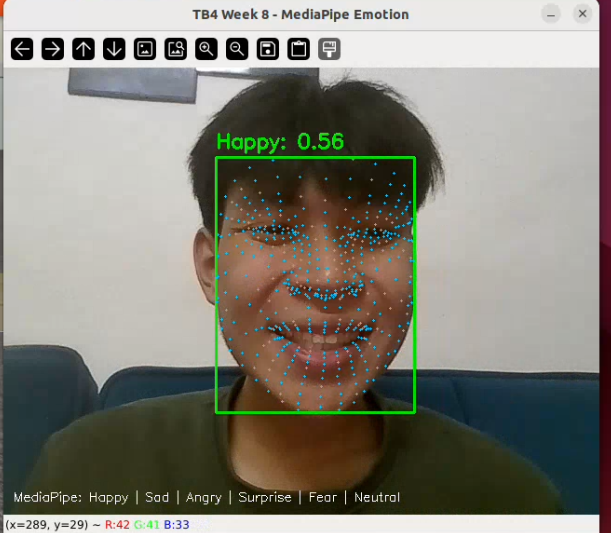

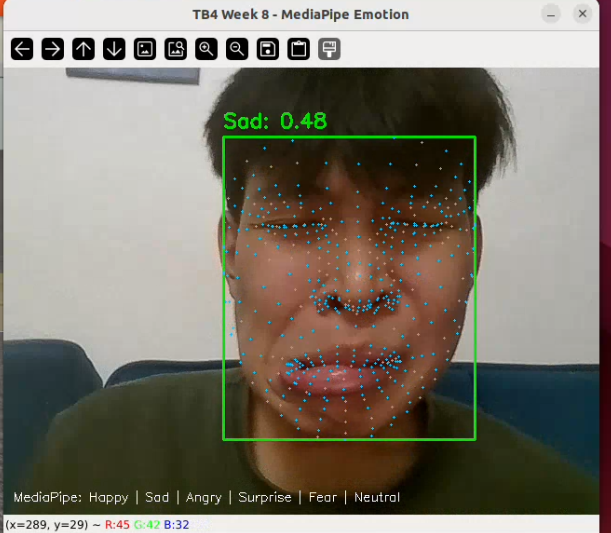

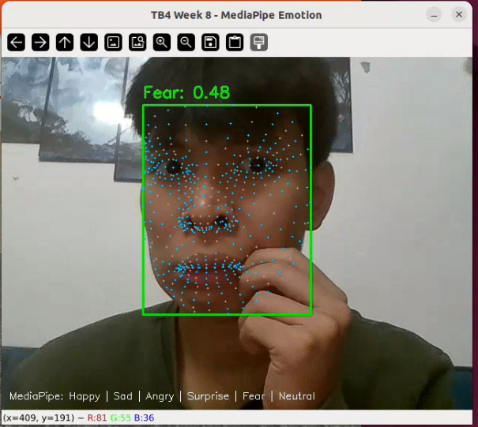

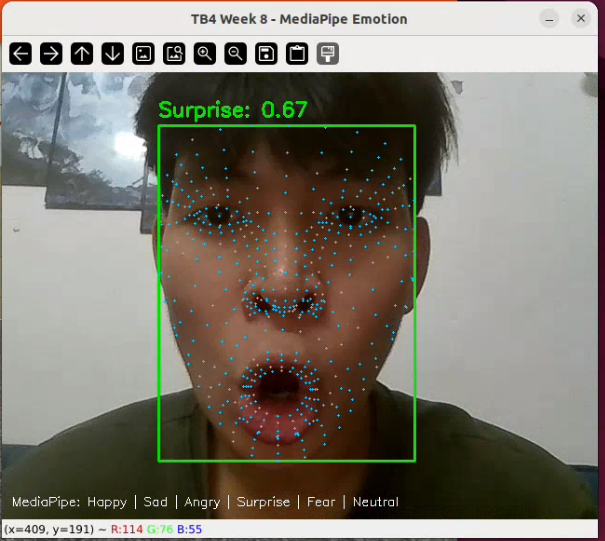

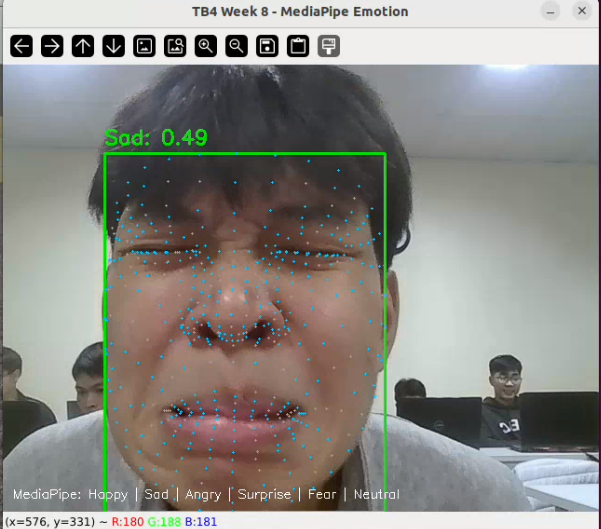

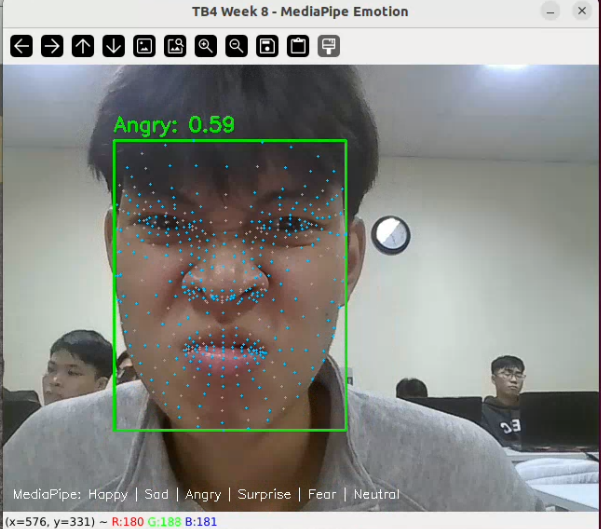

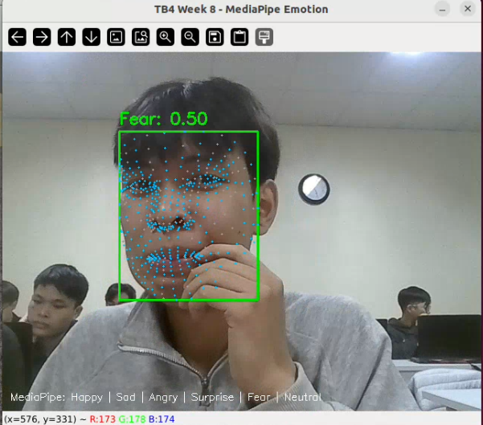

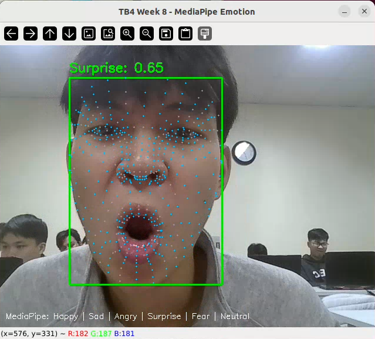

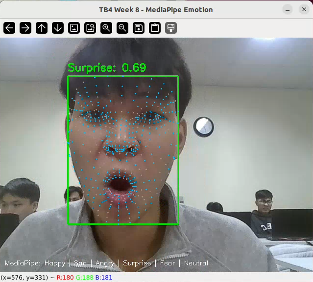

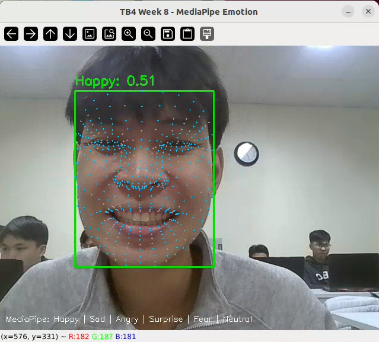

Cac anh tren duoc lay tu thu muc outputEmotion_week8 va dung trong bao cao Word tai docs/Bao_cao_tuan_8_nhan_dien_cam_xuc.docx.

## Cai dat

~~~bash
cd ~/ros2_ws
source /opt/ros/humble/setup.bash
python3 -m pip install --user mediapipe

colcon build --symlink-install \
  --base-paths src \
  --packages-select tb4_week8_emotion

source install/setup.bash
~~~

## Chay webcam

~~~bash
ros2 run tb4_week8_emotion emotion_recognition_node --ros-args \
  -p camera_index:=0 \
  -p backend:=mediapipe \
  -p show_window:=true \
  -p draw_landmarks:=true \
  -p show_debug_cues:=false
~~~

## Chay day du Small House

~~~bash
ros2 launch tb4_week8_emotion week8_emotion_control.launch.py \
  camera_index:=0 \
  emotion_backend:=mediapipe \
  draw_landmarks:=true \
  show_debug_cues:=false \
  show_window:=true \
  show_rviz:=true
~~~

Neu muon xem diem chan doan Sad/Angry/Fear, doi show_debug_cues:=true.
Neu khong muon hien landmark, doi draw_landmarks:=false.

## Topic chinh

| Topic | Y nghia |
|---|---|
| /facial_emotion | Nhan cam xuc on dinh |
| /facial_emotion_confidence | Confidence |
| /facial_emotion/image | Anh webcam da chu thich |
| /facial_emotion_status | Trang thai model/webcam |
| /emotion_behavior_status | Hanh vi TurtleBot |
| /cmd_vel | Van toc robot |

## Cau truc

~~~text
emotion_control/
├── tb4_week8_emotion/
│   ├── models/
│   │   ├── face_landmarker.task
│   │   └── hand_landmarker.task
│   ├── launch/
│   ├── rviz/
│   ├── tb4_week8_emotion/
│   │   ├── emotion_recognition_node.py
│   │   └── emotion_behavior_node.py
│   ├── package.xml
│   └── setup.py
├── results/
├── docs/
└── README.md
~~~

Cac package tb4_week6 va tb4_week7 can co trong cung workspace de chay mo phong Small House va ban do semantic.
